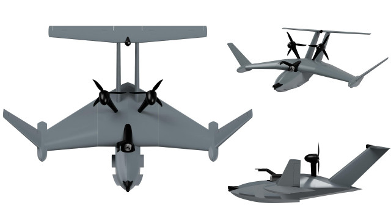

# Talay-Ekranoplan-3D
Detailed 3D model of the Talay ekranoplan (ground effect vehicle) created in Blender, including STL files and instructions for viewing.

## 📊 Technical Specifications
Due to the engineering scale of the real vehicle, the model dimensions are defined as follows:

| Parameter | Value |
| :--- | :--- |
| **Wingspan (Розмах крил)** | 3595 mm |
| **Length (Довжина)** | 2578 mm |
| **Height (Висота)** | 808 mm |
| **Wall Thickness (Товщина стінок)** | 0.5 mm |

---

## 🔍 Blender 3D Model Views
To fully demonstrate the geometry and detailing of the model, multiple perspectives from Blender are provided below:

* **Engineering & Front/Side Views:**

  
  

* **Top & Isometric Views:**

  
  

## ✈️ Comparison with Original
The 3D model was meticulously designed and modeled in Blender based on the original technical concept and visual references of the Talay ekranoplan. 

  

